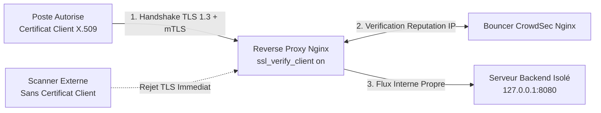

<!-- MASTER-HEADER-START -->
<div align="center">

<a href="https://0xcyberlitech.com/">
  
</a>

<p align="center">
  <a href="https://0xcyberlitech.com/"></a>
  <a href="https://0xcyberlitech.com/soc-rd.html"></a>
  <a href="https://0xcyberlitech.com/jarvis-rd.html"></a>
  <a href="https://github.com/0xCyberLiTech?tab=repositories"></a>
</p>
<p align="center">
  <a href="README.md"></a>
</p>


</div>
<!-- MASTER-HEADER-END -->

<!-- DEBIAN-TRUTH-START -->
> [!IMPORTANT]
>  ** Matrice Officielle Debian — `Debian 12 (Bookworm)` · `Debian 13 (Trixie)` · `Debian 14 (Forky)`**
> - **Sources Officielles Debian.org (`squid`) :** `Bookworm (12)` : **`5.7-2+deb12u5`** &nbsp;·&nbsp; `Trixie (13 — Stable)` : **`6.13-2+deb13u3`** &nbsp;·&nbsp; `Forky (14 — Next-Gen)` : **`7.7-1`**
> - **Références Officielles :** [Paquet Debian Trixie (`squid`)](https://packages.debian.org/trixie/squid) &nbsp;·&nbsp; [Paquet Debian Forky (`squid`)](https://packages.debian.org/forky/squid) &nbsp;·&nbsp; [Documentation Officielle Debian](https://packages.debian.org/trixie/squid)
> - **Note d'Ingénierie (Divergence 13 vs 14) :** Sous Debian 13 (Trixie) et Debian 14 (Forky), Squid 6+ privilégie l'inclusion modulaire dans **`/etc/squid/conf.d/`** plutôt que la modification directe du fichier maître `/etc/squid/squid.conf`.

<details>
<summary> <b>Afficher les Encarts Ligne de Commande : Debian 13 (Trixie — Stable) vs Debian 14 (Forky — Next-Gen)</b></summary>

####  Profil Production Stable — Commandes pour `Debian 13 (Trixie)`
```bash
# Debian 13 (Trixie — Squid 6.x) : Verification de la configuration & rechargement sans coupure
sudo squid -k parse && sudo systemctl reload squid
sudo tail -f /var/log/squid/access.log
```

####  Profil Anticipation Next-Gen — Commandes pour `Debian 14 (Forky)`
```bash
# Debian 14 (Forky — Squid 6.x/7.x) : Configuration modulaire dans /etc/squid/conf.d/*.conf
sudo journalctl -u squid.service -n 50 --no-hostname
```

</details>
<!-- DEBIAN-TRUTH-END -->

<!-- CIEL-PEDAGOGY-START -->
<details>
<summary> <b>Synthèse d'Architecture, Standards Officiels &amp; Diagnostic (Niveau 1 : Fondamentaux · Niveau 2 : Repères · Niveau 3 : Diagnostic)</b></summary>

- **Niveau 1 — Fondamentaux &amp; Principe d'Architecture :** Un **Serveur Proxy** agit comme passerelle intermédiaire de sécurité et de performance : en **Proxy Explicite / Sortant (Squid)**, il contrôle, journalise et met en cache les accès Web des postes internes ; en **Reverse Proxy (Nginx / HAProxy)**, il protège les applications internes derrière un point d'entrée unique (TLS, WAF, mTLS).
- **Niveau 2 — Repères Officiels (Ports IANA, Fichiers Debian &amp; Commandes de Validation) :** **Ports standards :** `TCP 3128` (Squid Forward Proxy) · `TCP 80 / 443` (Reverse Proxy HTTP/HTTPS) &nbsp;|&nbsp; **Fichiers Debian :** `/etc/squid/squid.conf`, `/etc/nginx/nginx.conf` &nbsp;|&nbsp; **Validation officielle :** `sudo squid -k parse` / `sudo nginx -t`.
- **Niveau 3 — Diagnostic d'Incidents &amp; Ingénierie Avancée :** **Diagnostic & Architecture :** Dans Squid, les directives `http_access` sont évaluées séquentiellement selon le principe du **premier match gagnant** : placez impérativement vos règles d'autorisation (`http_access allow <acl_lan>`) au-dessus de la règle de fermeture `http_access deny all`.
- **Sources de Vérité Officielles Éditeurs &amp; Standards :** [Documentation Officielle Squid Cache](https://www.squid-cache.org/Doc/config/) &nbsp;·&nbsp; [Documentation Officielle Nginx](https://nginx.org/en/docs/)
- **Livres Blancs &amp; 67 Podcasts Audio R&amp;D :** [Portail 0xCyberLiTech](https://0xcyberlitech.com/) &nbsp;·&nbsp; [Livre Blanc SOC Cockpit v5.5](https://0xcyberlitech.com/soc-rd.html) &nbsp;·&nbsp; [Livre Blanc JARVIS Mark-VII](https://0xcyberlitech.com/jarvis-rd.html) &nbsp;·&nbsp; [Blueprint Logiciel &amp; Matériel RTX 5080](https://0xcyberlitech.com/blueprint-jarvis.html)

</details>
<!-- CIEL-PEDAGOGY-END -->


#  Reverse Proxy Nginx Durci : TLS 1.3, Authentification Mutuelle (mTLS Zero-Trust) & WAF CrowdSec sur Debian 12, 13 & 14

> **Objectif Opérationnel :** Compléter l'architecture de filtrage sortant **Squid** par un **Reverse Proxy entrant Nginx durci** sous **Debian 12 (Bookworm)**, **Debian 13 (Trixie — Stable)** et **Debian 14 (Forky — Next-Gen)**, assurant la terminaison **TLS 1.3**, l'authentification par certificat client **mTLS (*Mutual TLS Zero-Trust*)** et l'inspection applicative par bouncer **CrowdSec**.

<div align="center">

| Niveau | Étape Technique | Accès Direct |
|:---:|:---|:---:|
| **Niveau 1** | Différence entre Forward Proxy (Squid) et Reverse Proxy Zero-Trust (Nginx mTLS) | [](#architecture-reverse-proxy-mtls) |
| **Niveau 2** | Installation de Nginx & Génération de l'Autorité de Certification Client mTLS | [](#installation-nginx-pki-mtls) |
| **Niveau 3** | Configuration du VirtualHost Nginx durci (TLS 1.3, HSTS, `ssl_verify_client on`) | [](#configuration-vhost-nginx-mtls) |
| **Niveau 3** | Intégration du Bouncer Nginx CrowdSec & Validation `nginx -t` | [](#bouncer-crowdsec-nginx-validation) |

</div>

---

<a id="architecture-reverse-proxy-mtls"></a>
##  01 // Différence entre Forward Proxy (Squid) et Reverse Proxy Zero-Trust (Nginx mTLS)


Alors qu'un **Forward Proxy (Squid)** filtre les requêtes des postes internes sortant vers Internet, un **Reverse Proxy (Nginx)** protège les applications critiques de l'entreprise (interfaces d'administration, SOC, API internes) exposées en entrée.

L'activation du **mTLS (*Mutual TLS*)** ajoute une barrière cryptographique pré-authentifiée : toute requête HTTP ne présentant pas un **certificat client X.509 signé par votre Autorité de Certification interne** est rejetée dès la poignée de main TLS (`400 Bad Request / SSL Certificate Error`), avant même d'atteindre l'application backend.



---

<a id="installation-nginx-pki-mtls"></a>
##  02 // Installation de Nginx & Génération de l'Autorité de Certification Client mTLS


Installez **Nginx** et **OpenSSL**, puis créez l'arborescence dédiée à l'Autorité de Certification (CA) qui signera les certificats de vos appareils autorisés :

<!-- CODE-WINDOW-START -->
> [!CAUTION]
> 
>
> ```bash
> sudo apt update
> sudo apt install -y nginx openssl
> sudo mkdir -p /etc/nginx/mtls && sudo chmod 700 /etc/nginx/mtls
> ```
<!-- CODE-WINDOW-END -->

Générez la clé privée et le certificat racine de votre CA mTLS interne, puis émettez un certificat client au format `.p12` (importable sur poste de travail ou smartphone) :

<!-- CODE-WINDOW-START -->
> [!CAUTION]
> 
>
> ```bash
> sudo openssl genrsa -out /etc/nginx/mtls/ca-mtls.key 4096
> sudo openssl req -x509 -new -nodes -key /etc/nginx/mtls/ca-mtls.key -sha256 -days 3650 \
>   -subj "/CN=0xCyberLiTech-mTLS-CA/O=0xCyberLiTech" -out /etc/nginx/mtls/ca-mtls.crt
>
> sudo openssl genrsa -out /etc/nginx/mtls/client-admin.key 4096
> sudo openssl req -new -key /etc/nginx/mtls/client-admin.key \
>   -subj "/CN=operateur-admin/O=0xCyberLiTech" -out /etc/nginx/mtls/client-admin.csr
> sudo openssl x509 -req -in /etc/nginx/mtls/client-admin.csr \
>   -CA /etc/nginx/mtls/ca-mtls.crt -CAkey /etc/nginx/mtls/ca-mtls.key -CAcreateserial \
>   -out /etc/nginx/mtls/client-admin.crt -days 365 -sha256
> ```
<!-- CODE-WINDOW-END -->

---

<a id="configuration-vhost-nginx-mtls"></a>
##  03 // Configuration du VirtualHost Nginx durci (TLS 1.3, HSTS, ssl_verify_client on)


Créez le fichier `/etc/nginx/sites-available/reverse-mtls.conf` imposant **TLS 1.3**, la vérification obligatoire du certificat client (`ssl_verify_client on`) et les en-têtes de sécurité :

<!-- CODE-WINDOW-START -->
> [!CAUTION]
> 
>
> ```ini
> server {
>     listen 443 ssl http2;
>     server_name soc.cyberlitech.lan;
>
>     ssl_certificate     /etc/ssl/certs/ssl-cert-snakeoil.pem;
>     ssl_certificate_key /etc/ssl/private/ssl-cert-snakeoil.key;
>     ssl_protocols       TLSv1.3;
>
>     ssl_client_certificate /etc/nginx/mtls/ca-mtls.crt;
>     ssl_verify_client      on;
>     ssl_verify_depth       2;
>
>     add_header Strict-Transport-Security "max-age=63072000; includeSubDomains" always;
>     add_header X-Content-Type-Options "nosniff" always;
>     add_header X-Frame-Options "DENY" always;
>
>     location / {
>         proxy_pass         http://127.0.0.1:8080;
>         proxy_http_version 1.1;
>         proxy_set_header   Host $host;
>         proxy_set_header   X-Real-IP $remote_addr;
>         proxy_set_header   X-Forwarded-For $proxy_add_x_forwarded_for;
>         proxy_set_header   X-SSL-Client-CN $ssl_client_s_dn;
>     }
> }
> ```
<!-- CODE-WINDOW-END -->

---

<a id="bouncer-crowdsec-nginx-validation"></a>
##  04 // Intégration du Bouncer Nginx CrowdSec & Validation nginx -t


Activez le site, installez la collection **CrowdSec Nginx** pour détecter les scans HTTP (`Nikto`, `Nuclei`, traversée de répertoires) et validez la syntaxe avant rechargement :

<!-- CODE-WINDOW-START -->
> [!CAUTION]
> 
>
> ```bash
> sudo ln -sf /etc/nginx/sites-available/reverse-mtls.conf /etc/nginx/sites-enabled/
> sudo cscli collections install crowdsecurity/nginx 2>/dev/null || true
> sudo nginx -t
> sudo systemctl reload nginx
> ```
<!-- CODE-WINDOW-END -->

Testez le rejet d'une requête sans certificat client puis l'accès autorisé avec votre certificat mTLS :

<!-- CODE-WINDOW-START -->
> [!CAUTION]
> 
>
> ```bash
> curl -k -I https://127.0.0.1:443/
> curl -k -I --cert /etc/nginx/mtls/client-admin.crt --key /etc/nginx/mtls/client-admin.key https://127.0.0.1:443/
> ```
<!-- CODE-WINDOW-END -->

<!-- MASTER-FOOTER-START -->
<div align="center">


<a href="https://0xcyberlitech.com/">
  
</a>

<p align="center"><a href="https://0xcyberlitech.com/"></a></p>

<sub><b>Architecturé &amp; Forgé par Marc &amp; Antigravity (Google DeepMind)</b> &nbsp;·&nbsp; <a href="https://0xcyberlitech.com/"><b>0xcyberlitech.com</b></a> &nbsp;·&nbsp; <a href="https://0xcyberlitech.com/soc-rd.html">Architecture SOC Cockpit v5.5</a> &nbsp;·&nbsp; <a href="https://0xcyberlitech.com/jarvis-rd.html">Architecture JARVIS Mark-VII</a> &nbsp;·&nbsp; <a href="https://0xcyberlitech.com/blueprint-jarvis.html">Blueprint Matériel RTX 5080</a></sub>

</div>
<!-- MASTER-FOOTER-END -->
